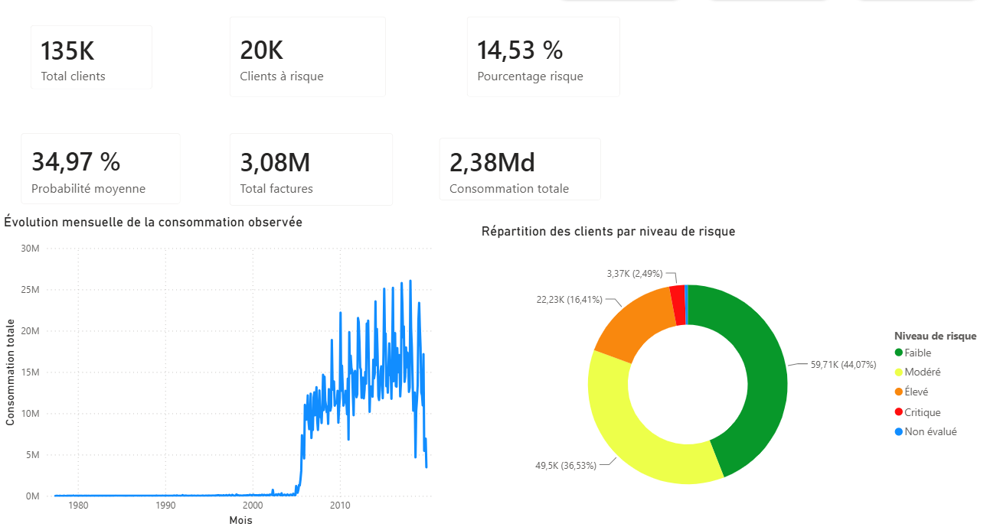
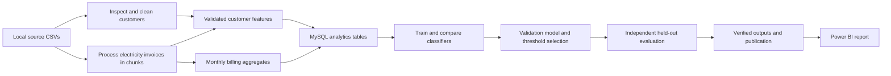
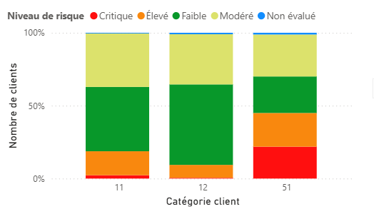
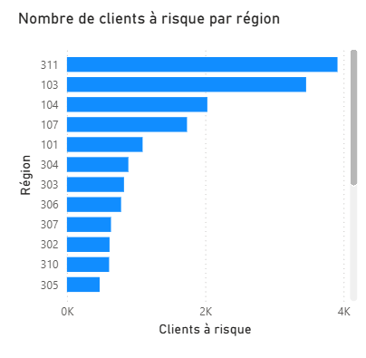
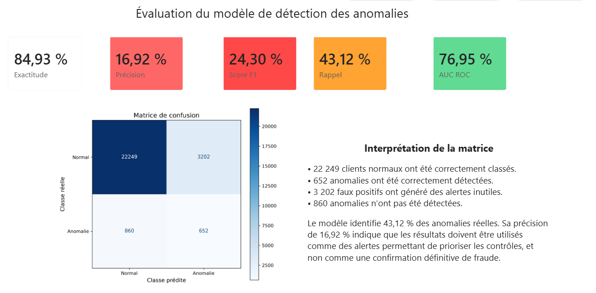
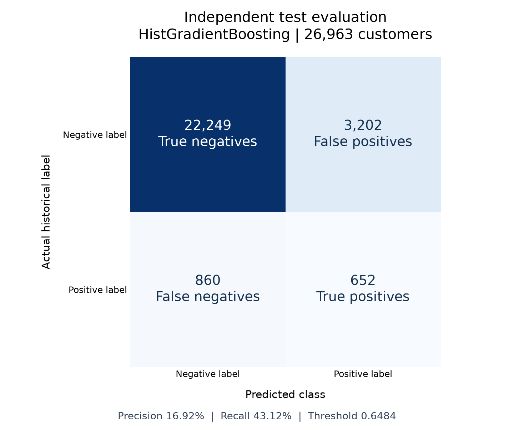

# EnergyInsight Tunisia

### Electricity billing analytics and customer risk prioritization

An engineering project that turns **4.48 million billing records** into validated customer features, a MySQL analytics layer, an independently evaluated classification model, and an interactive Power BI report.

Built by **Khaled Zouari** as an academic engineering project. The dataset is attributed to the Tunisian Company of Electricity and Gas (**STEG**) by its publisher, **Zindi**. This repository has no affiliation with, endorsement by, or production deployment at STEG.

**Stack:** Python · Pandas · scikit-learn · MySQL · SQLAlchemy · Power BI



## Business problem

Utility inspections are costly, and most customers do not carry a historical fraud label. The practical question is whether billing history can help **prioritize customers for review** while keeping the number of unnecessary inspections manageable.

EnergyInsight provides two complementary views:

- **Billing analytics:** customer coverage, invoiced consumption, billing activity, and geographic/category segmentation.
- **Risk prioritization:** a supervised customer score evaluated against historical labels, with explicit false-positive and missed-case counts.

The model supports investigation. A high score is not proof of fraud, and a low score is not evidence that a customer is compliant. Inspection cost, recovered revenue, and confirmed field outcomes are not available in this project; financial impact is therefore not claimed.

## Project scope and data provenance

The source is Zindi's [Fraud Detection in Electricity and Gas Consumption Challenge](https://zindi.world/competitions/fraud-detection-in-electricity-and-gas-consumption-challenge/data), whose documentation states that the data was provided by STEG. The implementation reads two local CSV files; it does not scrape the STEG website.

| Input / scope | Count |
|---|---:|
| Customer records | 135,493 |
| Original billing records | 4,476,749 |
| Electricity invoices used | 3,079,406 |
| Gas invoices outside this implementation's scope | 1,397,343 |
| Customers with a positive historical label | 7,566, or 5.58% |
| Customers eligible for modeling | 134,815 |
| Customers without usable electricity history | 678 |

The historical target is customer-level, while the current features use electricity invoices only. An electricity-specific fraud label has not been established. The task is **retrospective classification**, because the dataset does not provide a dated fraud diagnosis.

**Data is not included.** Zindi's [competition terms](https://zindi.world/competitions/fraud-detection-in-electricity-and-gas-consumption-challenge) restrict redistribution. Raw/processed customer files, individual predictions, trained model binaries, SQL dumps, credentials, and data-bearing PBIX files are excluded. This repository publishes implementation code, aggregate evaluation results, and aggregate dashboard captures.

## Architecture



The pipeline separates immutable inputs, provisional outputs, verification, and publication. Aggregate statistics are computed per customer, then joined with customer attributes using a validated one-to-one join.

| Stage | Implementation | Output |
|---|---|---|
| Inspection | `src/01_inspect_data.py` | Schema, types, initial quality checks |
| Customer cleaning | `src/02_clean_clients.py` | Clean IDs, typed attributes, creation date components |
| Invoice processing | `src/03_process_invoices.py` | Customer features and monthly billing aggregates |
| Exploration | `src/04_exploratory_analysis.py` | Descriptive plots and summary |
| SQL loading | `src/05_load_to_mysql.py` | MySQL analytics tables |
| Modeling | `src/06_train_model.py` | Model, validation comparison, test metrics, scores |
| Verification/publication | `run_all.py`, `reports/verify_project.py` | Consistent CSV/SQL outputs and integrity manifest |

Read the [architecture](docs/architecture.md), [modeling methodology](docs/methodology.md), [data quality findings](docs/data-quality.md), and [setup guide](docs/setup.md) for the design decisions and reproduction procedure.

## Power BI results

The report has three pages. Screenshots are captured from the actual local Power BI Desktop report. Its existing interface is in French; the documentation and interpretation here are in English. Only aggregate views are published.

### 1. Billing overview

Customer and invoice counts, aggregate billed consumption, monthly invoice-date trend, and score-band distribution. Overview scores include training, validation, and test customers, so this page is descriptive and must not be used to report independent model performance.


### 2. Customer risk segmentation

Aggregate risk-band distribution by customer category and positive-prediction counts by region. The customer-level inspection queue exists locally, but is deliberately outside the published capture.





### 3. Independent model performance

The evaluation page uses held-out test results and displays the confusion matrix alongside precision, recall, F1, accuracy, and ROC-AUC.



See [Power BI documentation](powerbi/README.md) for query sources, measure definitions, and interpretation caveats.

## Modeling and evaluation

Eligible customers are split into **60% training / 20% validation / 20% test**, stratified by target with random seed 42. Each customer appears in exactly one partition. Preprocessing is fitted inside a scikit-learn Pipeline, and three-fold cross-validation runs on training customers only.

Three models are compared: logistic regression, random forest, and histogram gradient boosting. Class weighting handles imbalance. The final model and decision threshold are chosen by validation F1, with validation Average Precision as a tie-breaker. The test set is used after this selection. This is an internal hold-out, not Zindi's official hidden test or leaderboard score.

| Candidate | Validation F1 at selected threshold | Validation Average Precision |
|---|---:|---:|
| Logistic regression | 0.1847 | 0.1135 |
| Random forest | 0.2265 | 0.1498 |
| **HistGradientBoosting** | **0.2305** | **0.1540** |

**Selected decision threshold:** `0.6484454589`. The published model remains trained on the training partition only, preserving the exact model/threshold pair evaluated on validation.

### Held-out test results

| Metric | Selected model | Always-negative baseline |
|---|---:|---:|
| Accuracy | 84.93% | 94.39% |
| Positive precision | 16.92% | 0% |
| Positive recall | 43.12% | 0% |
| F1 | 0.2430 | 0 |
| ROC-AUC | 0.7695 | 0.5000 |
| Average Precision | 0.1727 | 0.0561 |

The baseline's higher accuracy comes from predicting the majority class for every customer. It detects no positive cases. The selected model identifies **652 of 1,512 positive-labeled test customers**, but also produces **3,202 false positives**: 3,854 alerts in total. Approximately **83.08% of these alerts are false positives** relative to the provided labels.

This is a measurable ranking signal with a substantial inspection burden. The current result supports further work on prioritization, not autonomous fraud decisions.



Exact aggregate evidence is available in [docs/results](docs/results), including test metrics, candidate comparisons, baseline results, and model metadata.

## Engineering decisions and limitations

- **Explicit date formats:** customer dates are day/month/year; invoice dates are ISO year-month-day. An earlier ambiguous parser swapped 1,242,886 electricity dates. Strict ISO parsing restores the correct invoice-date assignment.
- **Chunked input:** invoices are read in batches of 200,000, loading seven required columns. Partial aggregations are combined before calculating the final means and population standard deviations.
- **Missing history is not zero consumption:** 678 customers without electricity invoices remain in reporting, with no score or prediction.
- **Category semantics:** district, region, and customer category are encoded as categorical values, not quantities.
- **Evaluation separation:** IDs, targets, absolute invoice dates, and split indicators are excluded from model features. Learned transformations are fitted on training data only.
- **Score interpretation:** the weighted classifier's outputs are not demonstrated calibrated probabilities. The dashboard's descriptive score bands differ from the binary decision threshold.
- **Coverage caveat:** local invoices begin in 1977, although Zindi describes a 2005–2019 history. There are 19,909 electricity invoices dated before 2005. This discrepancy remains a documented quality issue.
- **Billing caveat:** monthly aggregates group invoices by issue month; they do not allocate usage across the actual metering period. Units and national representativeness have not been established.
- **Publication caveat:** SQL table renaming and individual file replacements do not form a single cross-system transaction. Abrupt interruption can require restoration from backup.

The existing local full verification reports **128 successful checks**. This checks technical consistency, not the correctness of every historical label or business profitability. Full verification requires privately acquired source data and a configured MySQL server.

## Run and test

Use Python 3.13 with the pinned dependencies and a configured MySQL instance. The [setup guide](docs/setup.md) explains installation, private data acquisition, environment variables, SQL privileges, and execution.

```powershell
python -m venv .venv
.venv\Scripts\python.exe -m pip install -r requirements.txt
Copy-Item .env.example .env
# Configure .env, MySQL, and privately acquired files in data/raw/ first.
.venv\Scripts\python.exe run_all.py
.venv\Scripts\python.exe reports\verify_project.py
```

Data-independent regression tests can be run without the restricted dataset or MySQL:

```powershell
.venv\Scripts\python.exe -m unittest discover -s tests -p test_regressions.py -v
```

Full integration tests require a successful local pipeline run and its staging artifacts. Do not treat a skipped integration test as proof of a validated pipeline.

## Next engineering steps

1. Confirm date provenance, target definition, units, and the relationship between electricity features and the general customer fraud label.
2. Normalize consumption by valid billing-period length and evaluate meter/relevé attributes that were available before diagnosis.
3. Evaluate precision and recall at a fixed inspection capacity, rather than selecting the threshold from F1 alone.
4. Test score calibration and validate against a newer, independent cohort with dated outcomes.
5. Add operational monitoring and field-review feedback before considering deployment.

These are proposed improvements, not implemented capabilities.
